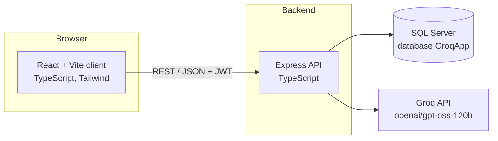

# Avaya Support Assistant (prototype)

An AI-powered customer service system for a contact centre vendor. Customers ask questions in a chat, by typing or by speaking, and get answers from a knowledge base. When the assistant cannot help, it prepares a support case that the customer reviews and submits. Support agents then work the case in their own dashboard and talk to the customer directly.

> **Status: prototype.** The knowledge base contains sample content and is not official Avaya information. Use fictional data only.

## Features

### For customers
- Sign up and log in.
- Chat with an AI assistant that answers from a searchable knowledge base.
- Replies in English, Malay, Mandarin and Cantonese.
- Voice input and read-aloud replies (Chrome).
- When the assistant has no answer, it drafts a support case. The customer checks the details and submits it; the AI never opens a case by itself.
- "My cases" page with each case's status and a live conversation with the support agent.
- Light and dark theme.

### For support agents
- Dashboard listing all cases, filterable by status and severity, with urgent cases first.
- Case detail with the customer's chat transcript.
- Change a case's status and assign it to an agent.
- Internal notes that customers can never see.
- Reply to customers inside the case.
- Knowledge base editor: add, edit, and switch articles on or off.

### Security and quality
- Passwords hashed with bcrypt; login tokens (JWT) that expire; automatic logout on an invalid token.
- Roles (customer or agent) enforced on the server, not just on screen.
- Every request validated with Zod; rate limits on login, sign-up, chat and messages; security headers with helmet; configurable CORS; the server refuses to start with a weak login secret.
- Customers never receive agent email addresses.
- 43 automated tests (Vitest) and a GitHub Actions workflow that runs lint, type checks, tests and a production build on every push.

## Architecture



The Groq API key and the database password stay on the server. The browser only ever talks to the Express API.

## Tech stack

| Area | Technology |
|---|---|
| Client | React 19, Vite, TypeScript, Tailwind CSS, react-markdown |
| Voice | Browser Web Speech API (input and read-aloud) |
| Server | Node.js, Express 5, TypeScript |
| Validation and security | Zod, bcryptjs, jsonwebtoken, helmet, express-rate-limit |
| Database | Microsoft SQL Server (Express edition for local development) |
| AI | Groq API (`openai/gpt-oss-120b`) with tool calling (`search_knowledge`, `open_case_form`) |
| Quality | Vitest, ESLint, GitHub Actions |

## Getting started (Windows, local)

**You will need:** Node.js 24, Git, SQL Server (Express or Developer edition) with SQL Server Management Studio, and a Groq API key from [console.groq.com](https://console.groq.com).

### 1. Get the code

```powershell
git clone https://github.com/HanMin021/groq-chat-app.git
cd groq-chat-app
```

### 2. Set up the database

In SQL Server Configuration Manager, enable TCP/IP on port 1433, and in SSMS turn on "SQL Server and Windows Authentication mode", then restart the SQL Server service. Then, in SSMS, run:

```sql
CREATE DATABASE GroqApp;
GO
CREATE LOGIN groq_app WITH PASSWORD = 'choose-a-strong-password';
GO
USE GroqApp;
GO
CREATE USER groq_app FOR LOGIN groq_app;
ALTER ROLE db_datareader ADD MEMBER groq_app;
ALTER ROLE db_datawriter ADD MEMBER groq_app;
```

Next, open `database/schema.sql`, select the `GroqApp` database in the toolbar, and run it. It creates all tables and 10 sample knowledge base articles.

### 3. Start the API

```powershell
cd server
Copy-Item .env.example .env
```

Open `server/.env` and fill in your Groq key, your database password and a long random `JWT_SECRET` (the file explains how to generate one). Then:

```powershell
npm install
npx tsx watch index.ts
```

The API listens on http://localhost:3000.

### 4. Start the website

In a second terminal:

```powershell
cd client
Copy-Item .env.example .env
npm install
npm run dev
```

Open http://localhost:5173, create an account, and start chatting.

### 5. Create an agent account

Sign up normally in the website, then promote that account in SSMS:

```sql
USE GroqApp;
UPDATE users SET role = 'agent' WHERE email = 'you@example.com';
```

Log in again to see the agent dashboard.

## Tests

### Shortcut: start everything with one command

After the setup above, you can start the API and the website together:

```powershell
powershell -ExecutionPolicy Bypass -File .\start-dev.ps1
```

This opens two windows: the API on port 3000 and the website on port 5173. Close the two windows to stop them.

```powershell
cd server
npm test
```

```powershell
cd client
npm run lint
npm run build
```

The same checks run automatically on GitHub for every push.

## Project structure

```
client/      React website
server/      Express API: routes in index.ts; data access in cases.ts,
             chats.ts, caseMessages.ts and kb.ts; input rules in validation.ts
database/    schema.sql (tables and sample data)
.github/     CI workflow
```

## Known limitations

- Prototype: not deployed, and not intended for real customer data yet.
- The knowledge base and severity levels are sample content, not official Avaya information.
- Knowledge search is keyword-based.
- Voice features work in Chrome. Chrome's speech recognition sends audio to Google, so use fictional data only.
- The whole conversation is sent to the AI on each message, and replies are not streamed.

## Roadmap

- Deployment (a hosted SQL Server database, the API and the website).
- Replace the sample content with real support content.
- Streaming replies.
- Voice testing in all four languages.